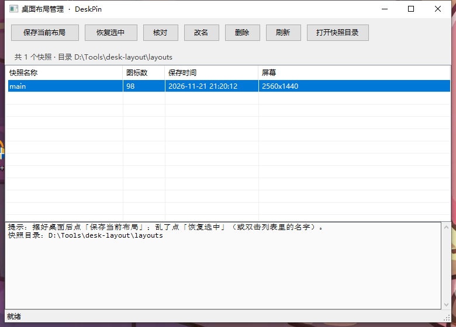

# DeskPin — 桌面图标布局快照 / 一键还原

Save and restore Windows desktop icon layouts with named profiles. Snapshots are stored in **primary-monitor relative coordinates**, so plugging/unplugging a secondary display does not move your icons. Built for the case where a display-config change (DisplayPort standby, a remote-desktop virtual monitor, taskbar height change) makes Explorer re-arrange every icon.

> 中文说明为主；代码是单文件 C#（.NET Framework 4.0），无第三方依赖。

生成日期：2026-11-21
路径：`D:\Tools\desk-layout\`
宿主：Windows 10 22H2 (19045) + Intel Arc B580 主屏 2560x1440 @100% + GameViewer/UU 虚拟屏 1180x820 @200%

## 为什么需要它

这台机器桌面图标位置存在注册表 `HKCU\Software\Microsoft\Windows\Shell\Bags\1\Desktop\IconLayouts`
（REG_BINARY，约 14 KB），是**单一坐标系**，不按分辨率分槽。所以：

- 显示器 DP 待机断连 / 亮屏、UU 远程串流拉起虚拟副屏、任务栏高度变化 —— 任意一次"显示配置变化"都会让 shell 按新尺寸重排图标；
- 桌面"自动排列"是关的（`FFlags` 无 bit0），乱序不是自动排列造成的，是配置切换造成的；
- 副屏 200% 缩放让坐标换算更复杂：跨屏移动时 shell 的 API 会按 DIP 换算，直接写会失败。

DeskPin 的做法：**把你摆好的那套布局整体存快照，需要时一键写回去**。

## 安装

### 方式一：直接下载（Release）

1. 到 **[Releases](https://github.com/K717112/desk-pin/releases/latest)** 下载 `DeskPin-v1.0.0-win.zip`，解压到任意目录（例如 `D:\Tools\desk-layout`）；
2. 双击 `DeskPinUI.exe`（或 `DeskPin.exe` 走命令行）；
3. 摆好桌面 → 点「保存当前布局」；桌面乱了 → 双击列表里的快照。

### 方式二：从源码构建

只需要 Windows 自带的 .NET Framework 4.0 编译器（`C:\Windows\Microsoft.NET\Framework644.0.30319\csc.exe`），不用装 Visual Studio：

```cmd
build.cmd
```

产物：`DeskPin.exe`（命令行）+ `DeskPinUI.exe`（图形界面）。

## 图形界面（推荐）

双击桌面「**桌面布局管理**」→ 打开 `DeskPinUI.exe`



- 列表显示所有快照（名称 / 图标数 / 保存时间 / 屏幕）
- 按钮：保存当前布局、恢复选中、核对、改名、删除、刷新、打开快照目录
- **双击列表里的一行 = 恢复那套布局**
- 右键列表也有同样的菜单
- 下方黑框是执行日志，操作结果一目了然；恢复期间按钮变灰、状态栏显示进度

命令行照旧可用（下面这套），UI 只是把命令包了一层。

## 用法

| 场景 | 操作 |
|---|---|
| 摆好后存一份 | 打开「桌面布局管理」→ 点「保存当前布局」；或 `DeskPin.exe save main` |
| 想多套布局 | UI 里点「保存当前布局」起任意名字；或 `DeskPin.exe save 游戏` / `save 工作` / `save 修图`（支持中文） |
| 变乱了切回来 | 打开「桌面布局管理」→ 双击 `main`（或选中后点「恢复选中」）；或 `DeskPin.exe restore main` |
| 切到另一套 | UI 里双击对应快照；或 `DeskPin.exe restore 游戏` |
| 看有哪些快照 | 打开「桌面布局管理」（桌面只留这一个入口），或 `DeskPin.exe list` |
| 改名 / 删除 | `DeskPin.exe rename 旧名 新名` / `DeskPin.exe delete 名字`（删除会留备份到 `layouts\_deleted\`） |
| 核对是否真的还原 | `DeskPin.exe verify main` |
| 兜底硬还原 | `DeskPin.exe restore main --hard`（写回注册表 + 重启 explorer，任务栏闪 1~2 秒） |
| 看当前状态 | `DeskPin.exe status` |

## 还原是怎么做的（重要）

1. **第一步：shell API 逐个设位置**（`IFolderView::SelectAndPositionItems`，PIDL 拆成 child PIDL）。
   主屏内部的项一次到位。
2. **第二步：独立进程用 ListView 物理像素补齐**（`LVM_SETITEMPOSITION`）。
   跨显示器、副屏 200% 缩放导致 API 换算失败的项，在这一步按物理像素写回。
3. **核对**：新起一个进程重新读一遍坐标，跟快照比，输出"一致 N / 总数"。
4. 桌面图标不允许重叠：目标格被占时系统会把图标挤开，所以两步都按"目标格空才写"处理；个别项没到位时**再执行一次 restore 即可补齐**。

> 整个过程**不重启 explorer**（没有闪烁）。`--hard` 才重启，仅作兜底。

## 增删文件的行为（不会报错）

- 快照里有、现在没有的（文件被删/改名）→ 跳过，`verify` 里计入"已不存在"；
- 现在有、快照里没有的（新建了文件）→ **保持原位，不参与定位**，不会被挪走；
- 因此新加的快捷方式不会打乱老布局，但也不会自动归位 —— 摆好后重新 `save` 一次，把它纳入快照。

## 已知限制

| 限制 | 说明 |
|---|---|
| 分辨率变了再还原 | 坐标按原值写回，若新分辨率更小，右侧/底部图标会被夹到可见范围内（位置会挤，不会消失） |
| 副屏插拔 | 快照按「**主屏相对坐标**」保存（v1.0.1 起）：副屏拔掉/接上后，主屏上的图标位置不变；原本摆在副屏上的图标，无副屏时会被夹回主屏，接回副屏后回到原位 |
| 图标间距变化 | 跨 DPI 或插拔副屏会让 shell 的图标间距从 `100` 变 `98`。还原后按**当前间距**对齐（每个图标仍在自己那一行），`verify` 以半个格距为容差判定，不算失败 |
| 自动排列图标 | 必须保持关闭（右键桌面 → 查看 → 取消「自动排列图标」），否则写完立刻被系统抹掉 |
| 桌面图标数量变化 | 快照不记录"项的顺序"，靠名字匹配，删了再加同名文件也能对上 |

## 文件

```
D:\Tools\desk-layout\
├─ DeskPin.exe            命令行主程序（C# / .NET 4.0，本机 csc 编译）
├─ DeskPinUI.exe          图形界面（同上，WinForms）
├─ build.cmd              重新编译（csc 4.0.30319）
├─ src\DeskPin.cs         源码（单文件，约 1500 行）
├─ layouts\               快照目录（*.json，含坐标清单 + 注册表 IconLayouts 二进制）
│  ├─ main.json           当前基线
│  ├─ _history\           每次覆盖前的自动备份
│  └─ _deleted\           删除的快照备份
├─ 保存布局.bat / 恢复布局.bat / 布局管理.bat（命令行备用；桌面只留「桌面布局管理」一个入口）
└─ README.md              本文件
```

## 撤销 / 卸载

```powershell
# 1) 删桌面快捷方式
Remove-Item "$env:USERPROFILE\Desktop\保存桌面布局.lnk","$env:USERPROFILE\Desktop\恢复桌面布局.lnk","$env:USERPROFILE\Desktop\桌面布局管理.lnk"
# 2) 删工具与快照
Remove-Item "D:\Tools\desk-layout" -Recurse -Force
```

没有常驻进程、没有开机自启、没有监听端口、没改系统设置。

## 编译

```cmd
D:\Tools\desk-layout\build.cmd
```

依赖 `C:\Windows\Microsoft.NET\Framework64\v4.0.30319\csc.exe`（系统自带）+ `System.Web.Extensions.dll`（JSON 序列化）。
